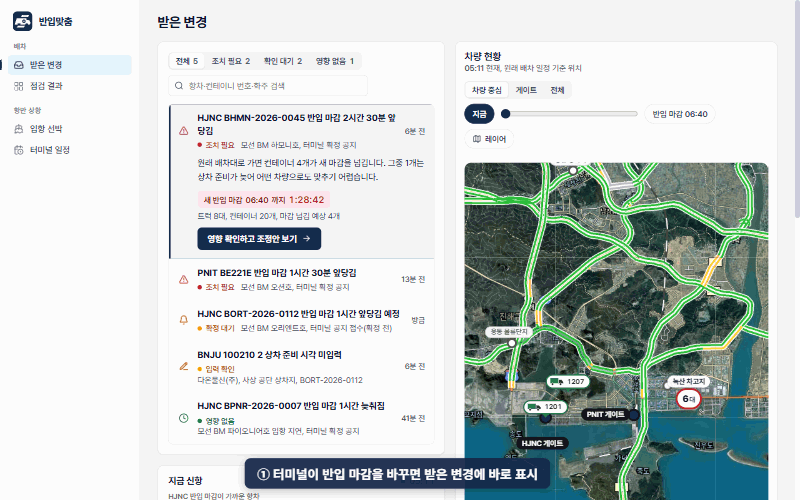
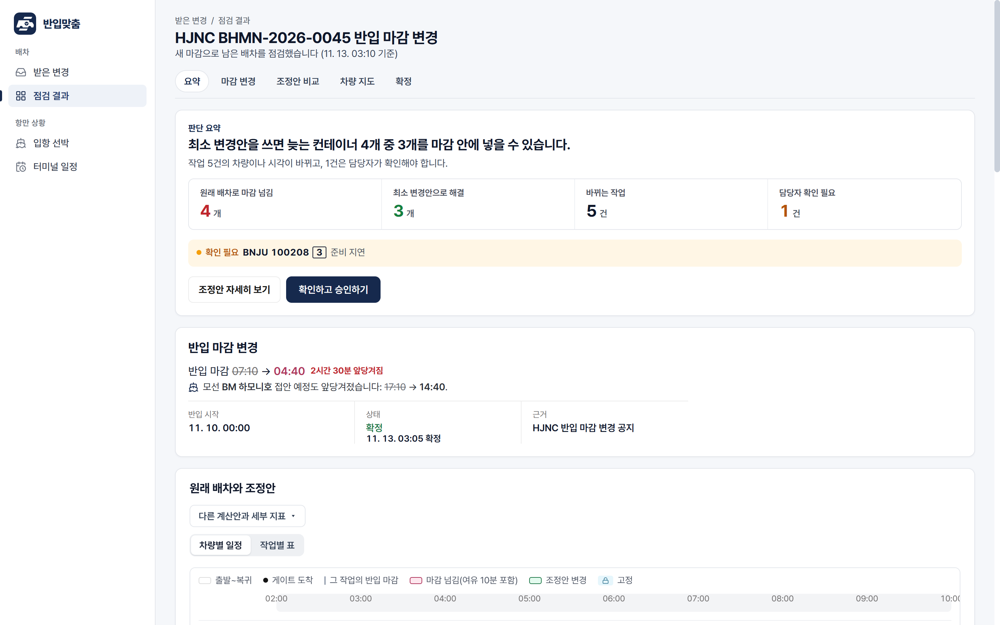
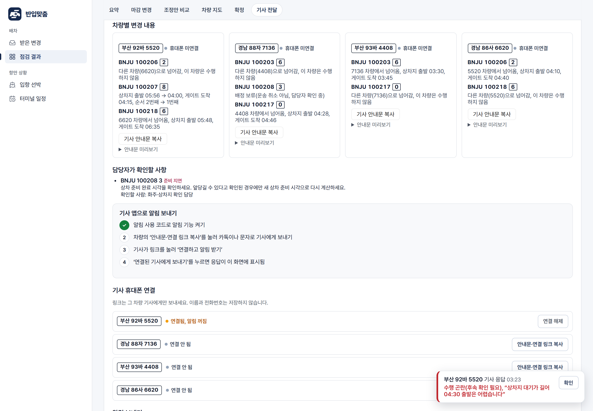
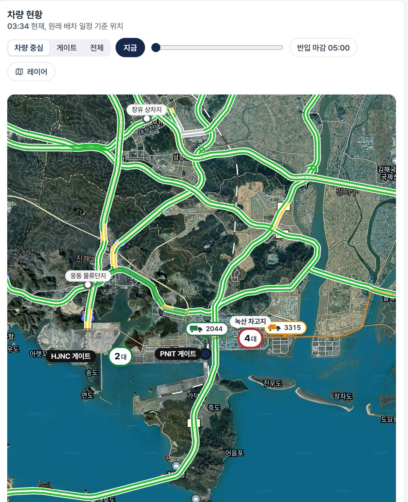
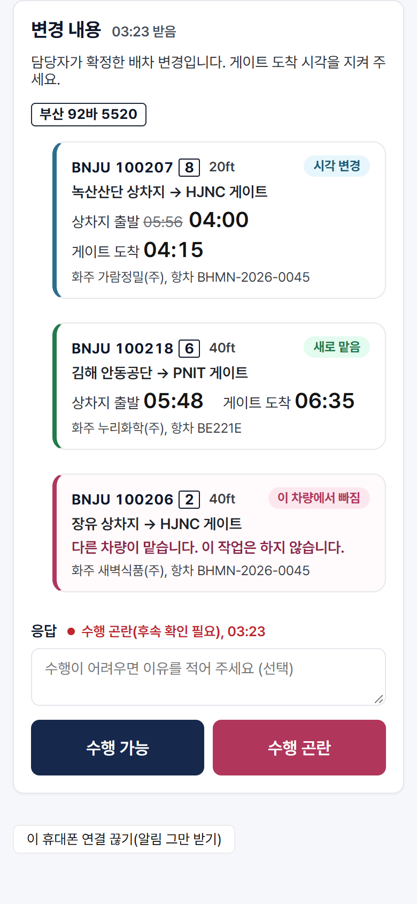

<p align="center"></p>

<h1 align="center">반입맞춤</h1>
<p align="center"><b>부산항 신항 수출 컨테이너의 반입 마감이 바뀌면,<br>남은 배차를 가장 적게 고쳐 다시 맞추고 바뀐 차량의 기사에게만 알린다.</b></p>
<p align="center">
  <a href="https://banipmatch.duckdns.org">운영 서비스</a> ·
  <a href="docs/report/final/report.html">문제해결 보고서</a> ·
  <a href="docs/deployment/production.md">운영 서버</a> ·
  <a href="backend/engine/OPTIMIZATION.md">최적화 모형</a>
</p>
<p align="center">2026 국립창원대학교 스마트물류 문제해결 경진대회(2nd LogisticSolver 2026) · 팀 반입맞춤 · <a href="CHANGELOG.md">v1.0.0</a></p>

<p align="center"></p>

---

## 무엇을 해결하나

터미널이 반입 마감(CCT)을 바꾸면 운송사 배차 담당자는 남은 배차표를 손으로 다시 짜고, 기사에게 전화·카톡으로 하나씩 알린다. 반입맞춤은 확정된 변경을 받는 즉시 다음을 한다.

1. **영향 점검** — 원래 배차대로면 새 마감을 넘기는 컨테이너와 원인을 계산한다.
2. **최소 변경 재배차** — 이미 출발한 작업은 그대로 두고, 마감을 넘기는 컨테이너를 먼저 줄인 뒤 바뀌는 작업 수를 줄인다(OR-Tools CP-SAT 사전식 최적화).
3. **조건 보완** — 상차 준비 시각, 차량 추가, 오늘 운행 불가를 넣어 다시 계산하고 전후를 비교한다.
4. **확정과 기사 전달** — 담당자가 확정하면 바뀐 차량의 기사에게만 안내문과 웹 푸시를 보내고, 기사는 '수행 가능' 또는 '수행 곤란'으로 답한다.

| | 원래 배차 | 마감순 재배치 | 전체 재배치 | **최소 변경안** |
|---|---:|---:|---:|---:|
| BHMN 마감 2시간 30분 앞당김: 마감 초과 운행 | 4 | 0 | 0 | **0** |
| 같은 사례: 바뀌는 작업 / 연락할 기사 | 0 / 0 | 16 / 8 | 11 / 7 | **5 / 4** |
| BE221E 마감 1시간 30분 앞당김: 바뀌는 작업 | — | 16 | 16 | **2** |

모의 배차(작업 20건·차량 8대) 기준 계산 결과다. 재현: `python tools/report_demo_scenarios.py`

### 상황별 처리

| 받은 공지 | 처리 |
|---|---|
| 마감 앞당김(확정) | 늦는 컨테이너와 원인을 찾고 최소 변경안을 계산한다. 어떤 차량으로도 맞출 수 없는 건은 미배정과 원인을 알린다 |
| 마감 늦춰짐(확정) | 원래 배차로 문제가 없으면 바꿀 작업 0건으로 끝낸다 |
| 마감 변경 예정(확정 전) | 배차를 바꾸지 않고, 공지대로 확정될 때의 영향만 미리 보여 준다 |
| 상차 준비 시각 누락 | 0분으로 가정하지 않고 계산을 멈춘 뒤, 담당자가 값을 채우면 다시 계산한다 |
| 현장 조건 변화 | 준비 시각·차량 추가·운행 불가를 입력해 같은 기준으로 다시 계산하고 전후를 비교한다 |

## 화면

| 점검 결과 | 기사 전달·응답 |
|---|---|
|  |  |
| **차량 지도(위성·실시간 교통)** | **기사 휴대폰** |
|  |  |

## 데이터

| 자료 | 제공처 | 구분 |
|---|---|---|
| 선석 배정·반입 시작/마감 | HJNC 공개 조회(서버가 1시간마다 수집) | 실제 |
| 해상 관측·특보 | 기상청 API허브(30분마다 수집, 일 한도의 0.5%) | 실제 |
| 지도·위성·실시간 교통 | 카카오 지도 JavaScript API | 실제 |
| 도로 경로 | OpenStreetMap · OSRM | 실제 |
| 기사 알림·위치 | Web Push(VAPID), 브라우저 위치(기사 동의 시) | 실제 |
| 배차표·차량·컨테이너 | 팀 제작 모의 자료(거리·시간은 실제 도로 기준) | 모의 |

| 데이터 | 위치 |
|---|---|
| 실제 자료 수집 코드(HJNC·기상청, 한도·실패 처리) | [`tools/collect_live_reference.py`](tools/collect_live_reference.py) |
| 실제 응답 검증 기록(HJNC·기상청·도로공사·AIS·ORS) | [`docs/data/`](docs/data) |
| 시연 공지 5종 모의 배차 입력 | [`frontend/src/fixtures/demo-02-*.synthetic.json`](frontend/src/fixtures) |
| 도로 경로(OSM·OSRM) | [`frontend/src/fixtures/road-routes.osm.json`](frontend/src/fixtures/road-routes.osm.json) |
| 실험 입력·결과(80회 평가, 견고성, 시연 사례) | [`docs/experiments/`](docs/experiments) |
| 입력 규격(OpenAPI·JSON Schema·SQL)과 예제 | [`docs/development/`](docs/development) |

수집·한도·품질 규칙은 [보고서 2장](docs/report/final/report.html)에 있다.

## 구조

```
backend/
  engine/      배차 엔진: 원래 배차·마감순·전체 재배치·최소 변경안 (OR-Tools CP-SAT), 모형 설명 OPTIMIZATION.md
  workflow/    공개 운영 API: 작업공간·계산 대기열·독립 검사·확정·기사 전달·응답·위치
  api/ data/   입력 검증, v0.1 계약, 실제 자료 표시 변환
frontend/      담당자 화면·기사 화면 (React + TypeScript + Vite, PWA)
tools/         실제 자료 수집, 실험·보고서 재현, 제출 묶음 생성
tests/         서버·엔진·계약 시험 (pytest)
docs/          보고서, 개발 계약(v0.1/v0.2), 실험 원자료, 자료 검증, 팀 문서
deployment/    운영 서버 설정 예시 (Caddy, systemd, 환경 변수)
```

## 직접 실행하기

Python 3.12, Node.js 24가 필요하다.

```powershell
# 서버
python -m venv .venv
.\.venv\Scripts\python.exe -m pip install -r requirements-dev.txt -r backend/data/requirements.txt -r requirements-workflow.txt
$env:BANIPMATCH_DEMO='1'; $env:BANIPMATCH_WORKFLOW='1'; $env:BANIPMATCH_RUN_MODE='engine'
$env:BANIPMATCH_CORS_ORIGINS='http://localhost:5173'
.\.venv\Scripts\python.exe -m uvicorn backend.webapp:create --factory --port 8000

# 화면 (다른 터미널)
cd frontend
npm ci --ignore-scripts
$env:VITE_API_MODE='v2'; npm run dev   # http://localhost:5173
```

지도와 기사 알림은 각각 카카오 JavaScript 키와 VAPID 키가 필요하다(`.env.example`, `deployment/cloud/app.env.example` 참고). 키 없이도 배차 계산·확정·조건 보완은 동작한다. 운영 배포는 [docs/deployment/production.md](docs/deployment/production.md).

## 시험

```powershell
.\.venv\Scripts\python.exe -m pytest -q          # 서버·엔진 668개
cd frontend; npm test                            # 화면 183개
python tools/check_engine_robustness.py .        # 무작위 입력 24회, 별도 규칙 검사
```

GitHub Actions가 모든 PR에서 서버·화면·계약 검사를 실행한다.

## 팀

| 이름 | 역할 |
|---|---|
| 황대겸 | 팀장 · 최적화 엔진 · 통합 · 운영 배포 · 보고서 |
| 안선효 | 서버 API · DB · 알림 |
| 최길웅 | 담당자·기사 화면 · 사용성 |
| 심민준 | 실제 자료 검증 · 모의 데이터 |

팀 개발 규칙과 이전 안내는 [docs/team/developer-guide.md](docs/team/developer-guide.md), [CONTRIBUTING.md](CONTRIBUTING.md).

## 출처와 라이선스 표기

지도 © Kakao, 도로 자료 © OpenStreetMap contributors(ODbL), 경로 계산 OSRM, 기상 자료 기상청 API허브, 선석 일정 HJNC 공개 조회, 아이콘 Lucide(ISC), 최적화 Google OR-Tools(Apache 2.0). 선박명·회사명·배차 자료는 가상이다.
