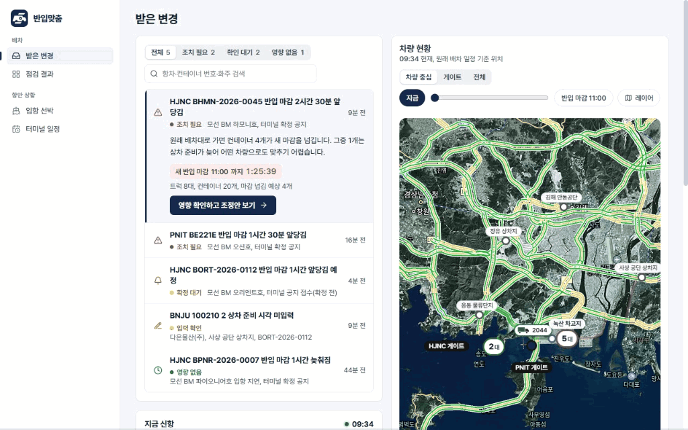
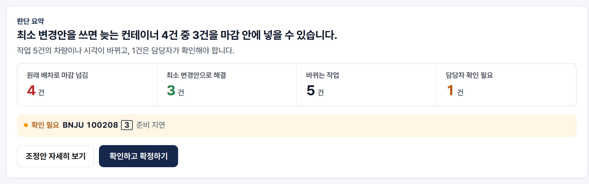
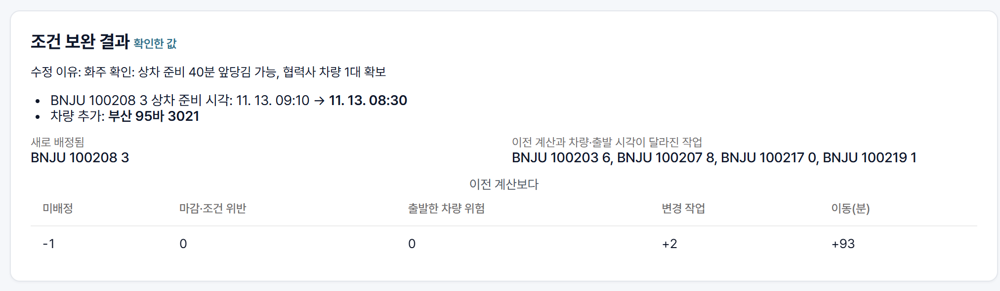
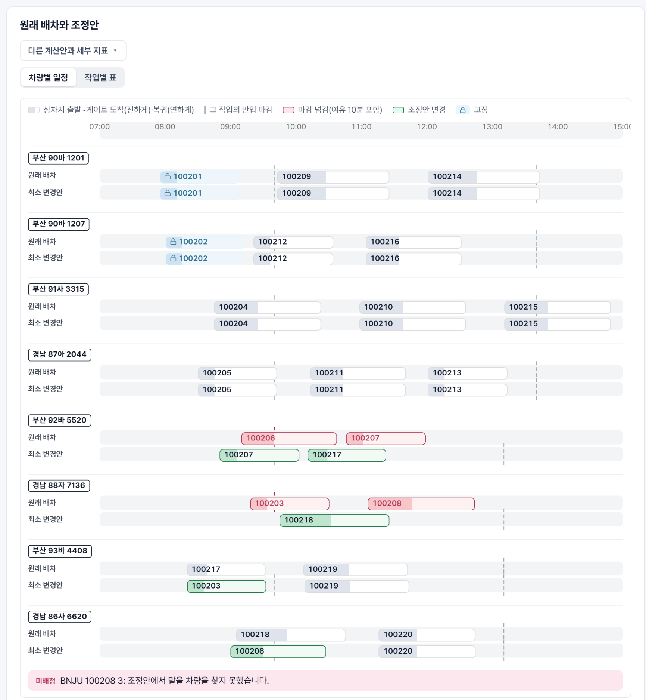
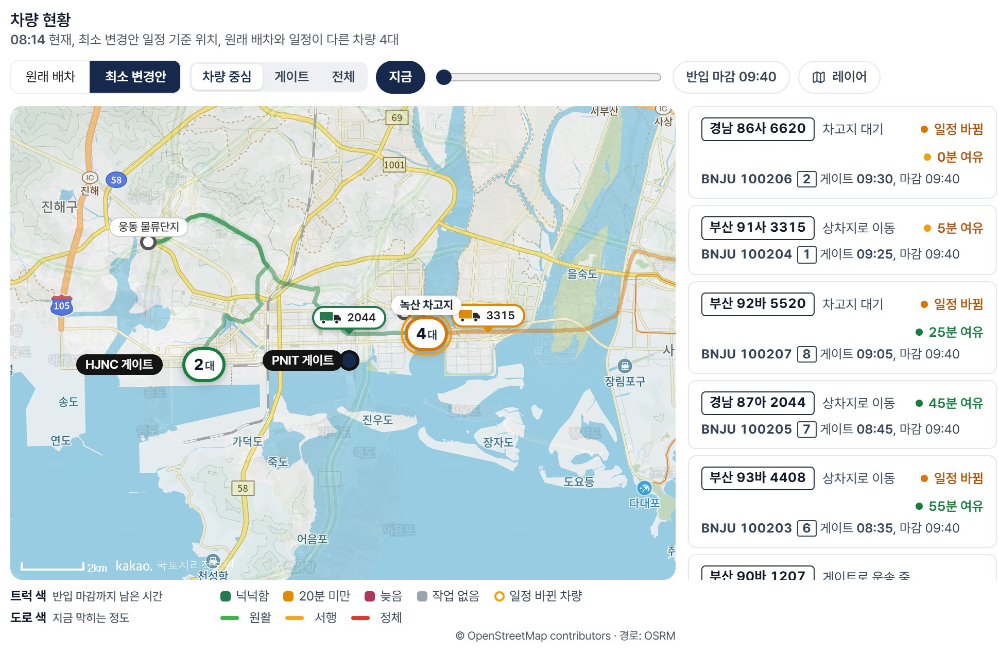
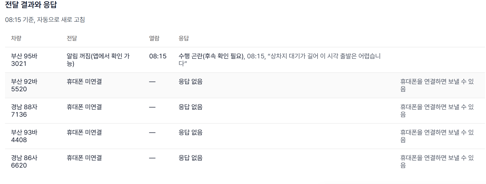
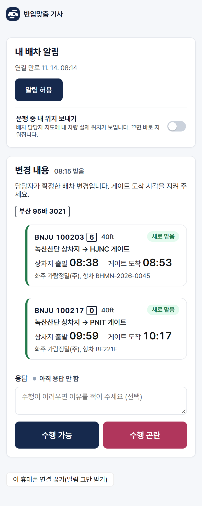

<p align="center"></p>

<h1 align="center">반입맞춤</h1>

<p align="center">
  부산항 신항 컨테이너 운송사를 위한 배차 조정 서비스입니다.<br>
  터미널이 반입 마감을 바꾸면 남은 배차를 가장 적게 고쳐 다시 맞추고, 일정이 바뀐 기사에게만 알려 줍니다.
</p>

<p align="center">
  <a href="https://banipmatch.duckdns.org"><b>서비스 열기</b></a> |
  <a href="docs/report/final/report.html">문제해결 보고서</a> |
  <a href="backend/engine/OPTIMIZATION.md">최적화 모형</a> |
  <a href="docs/deployment/production.md">운영 서버 구성</a> |
  <a href="CHANGELOG.md">변경 이력(v1.0.0)</a>
</p>

<p align="center">
  <a href="https://github.com/unknownamed/banipmatch-public/actions/workflows/development-checks.yml"></a>
  <a href="https://github.com/unknownamed/banipmatch-public/actions/workflows/frontend-checks.yml"></a>
</p>

<p align="center"></p>
<p align="center"><sub>운영 중인 서비스를 실제로 조작한 화면입니다(약 2분). 변경을 받은 뒤 기사 휴대폰에 알림이 가고 기사가 답할 때까지의 과정을 담았습니다.</sub></p>

2026 국립창원대학교 스마트물류 문제해결 경진대회에 낸 팀 반입맞춤의 작품입니다.

## 만든 이유

터미널이 수출 컨테이너의 반입 마감(CCT)을 바꾸면, 운송사 배차 담당자는 남은 배차표를 손으로 다시 짜고 일정이 바뀐 기사에게 전화나 메신저로 하나씩 알려야 합니다. 마감이 앞당겨질수록 시간은 부족한데 고칠 곳은 많아집니다. 반입맞춤은 변경을 받는 순간부터 기사의 답을 받을 때까지를 한 화면에서 끝낼 수 있게 만들었습니다.

## 주요 기능

1. **영향 점검.** 바뀐 마감을 받으면 원래 배차대로 갈 때 마감을 넘기는 컨테이너가 몇 건인지, 왜 늦는지부터 보여 줍니다.
2. **최소 변경 재배차.** 이미 출발한 차량은 그대로 두고, 늦는 컨테이너를 최대한 줄인 다음 바뀌는 작업이 가장 적은 배차를 찾습니다.
3. **조건 보완.** 화주가 상차 준비를 앞당길 수 있거나 차량을 더 구했다면 그 조건을 넣어 다시 계산하고 전후를 비교합니다. 오늘 운행할 수 없는 차량도 뺄 수 있습니다.
4. **확정과 기사 전달.** 담당자가 확정하면 일정이 바뀐 차량의 기사에게만 변경 내용과 알림을 보냅니다. 기사는 앱을 설치하지 않고 링크로 연결해 '수행 가능' 또는 '수행 곤란'으로 답하고, 그 답은 담당자 화면에 바로 표시됩니다.

받은 공지에 따라 처리 방식이 달라집니다.

| 받은 공지 | 처리 방식 |
|---|---|
| 마감이 앞당겨짐(확정) | 늦는 컨테이너와 원인을 찾고 최소 변경안을 계산합니다. 어떤 차량으로도 맞출 수 없는 건은 미배정으로 두고 이유를 알려 줍니다. |
| 마감이 늦춰짐(확정) | 원래 배차로 문제가 없으면 아무것도 바꾸지 않습니다. |
| 마감 변경 예정(확정 전) | 배차는 그대로 두고, 공지대로 확정되면 어떤 영향이 있는지만 미리 보여 줍니다. |
| 상차 준비 시각이 비어 있음 | 0분으로 가정하지 않고 계산을 멈춥니다. 담당자가 값을 채우면 다시 계산합니다. |
| 현장 조건이 바뀜 | 준비 시각, 추가 차량, 운행 불가 차량을 넣어 같은 기준으로 다시 계산하고 전후를 비교합니다. |

## 바로 써 보기

운영 중인 서비스에서 약 5분이면 처음부터 끝까지 해 볼 수 있습니다.

1. https://banipmatch.duckdns.org 에 접속합니다. 가입은 필요 없고, 방문자마다 따로 작업공간이 열립니다(24시간).
2. **받은 변경**에서 'HJNC BHMN … 반입 마감 2시간 30분 앞당김'을 고르고 **영향 확인하고 조정안 보기**를 누릅니다. 10초쯤 뒤 점검 결과가 나옵니다.
3. **점검 결과**에서 요약, 조정안 비교(시간 막대), 차량 지도를 차례로 봅니다.
4. **조건 보완**에서 확인이 필요한 컨테이너(BNJU 100208 3)의 상차 준비 시각을 40분 앞당기고, 외부 차량 1대를 추가합니다(시작 위치 녹산 차고지, 20ft·40ft 모두 선택, 운행 시작은 앞당긴 준비 시각, 근무 종료는 그 4시간 뒤). 그다음 **다시 계산**을 누릅니다. 남아 있던 1건까지 배정되고 전후 비교가 나옵니다.
5. **확정**에서 남는 위험을 확인하고 확정하면 **기사 전달**에 차량별 변경 내용과 기사 안내문이 나옵니다.
6. **기사 전달**의 '알림 사용 코드'에 코드를 넣고 **알림 기능 켜기**를 누릅니다. 실제 휴대폰 알림을 남용하지 않도록 둔 코드이고, 심사위원께는 제출한 보고서 4.1절에 적어 드렸습니다.
7. 차량 하나의 **안내문·연결 링크 복사**로 받은 링크를 휴대폰에서 열고 **연결하고 알림 받기**를 누릅니다. 카카오톡 안에서 열렸다면 다른 브라우저로 여세요. 아이폰은 공유 버튼에서 '홈 화면에 추가'한 뒤 엽니다.
8. PC에서 **연결된 기사에게 보내기**를 누르면 휴대폰에 알림이 옵니다. 휴대폰에서 '수행 가능' 또는 '수행 곤란'으로 답하면 PC 화면에 바로 표시됩니다.

왼쪽 메뉴의 **입항 선박**과 **터미널 일정**에서는 서버가 수집한 HJNC 일정과 기상청 관측을 볼 수 있습니다.

## 화면

| 점검 결과 | 조건 보완 결과 |
|---|---|
|  |  |

**원래 배차와 최소 변경안 비교.** 차량마다 위 줄이 원래 배차, 아래 줄이 최소 변경안입니다. 빨간 막대는 마감을 넘기는 작업, 초록 막대는 바뀐 작업입니다.



**차량 지도.** 차량 위치와 반입 마감까지 남은 시간, 실시간 교통을 함께 보여 줍니다.



| 담당자 화면에 표시된 기사 응답 | 기사 휴대폰 |
|---|---|
|  |  |

## 계산 결과

모의 배차(작업 20건, 차량 8대)에서 네 가지 방법을 같은 입력과 같은 계산 시간으로 비교했습니다.

| 사례 | 원래 배차 | 마감순 재배치 | 전체 재배치 | 최소 변경안 |
|---|---:|---:|---:|---:|
| BHMN 마감 2시간 30분 앞당김: 마감을 넘기는 운행 | 4 | 0 | 0 | **0** |
| 같은 사례: 바뀌는 작업 / 연락할 기사 | 0 / 0 | 16 / 8 | 11 / 7 | **5 / 4** |
| BE221E 마감 1시간 30분 앞당김: 바뀌는 작업 | - | 16 | 16 | **2** |

`python tools/report_demo_scenarios.py`로 같은 결과를 다시 계산할 수 있습니다.

## 시작하기

Python 3.12와 Node.js 24가 필요합니다.

```powershell
# 서버
python -m venv .venv
.\.venv\Scripts\python.exe -m pip install -r requirements-dev.txt -r backend/data/requirements.txt -r requirements-workflow.txt
$env:BANIPMATCH_DEMO='1'; $env:BANIPMATCH_WORKFLOW='1'; $env:BANIPMATCH_RUN_MODE='engine'
$env:BANIPMATCH_CORS_ORIGINS='http://localhost:5173'
.\.venv\Scripts\python.exe -m uvicorn backend.webapp:create --factory --port 8000

# 화면 (다른 터미널에서)
cd frontend
npm ci --ignore-scripts
$env:VITE_API_MODE='v2'; npm run dev   # http://localhost:5173
```

지도를 보려면 카카오 JavaScript 키가, 기사 알림을 보내려면 VAPID 키가 필요합니다. 설정 방법은 `.env.example`과 `deployment/cloud/app.env.example`에 있습니다. 키가 없어도 배차 계산, 조건 보완, 확정은 그대로 동작합니다. 운영 서버를 올리는 방법은 [운영 서버 구성](docs/deployment/production.md)에 정리했습니다.

## 기술 스택

| 영역 | 사용 기술 |
|---|---|
| 배차 계산 | Python 3.12, Google OR-Tools CP-SAT |
| 서버 | FastAPI, SQLite(방문자마다 따로 쓰는 작업공간), 웹 푸시(VAPID) |
| 화면 | React 18, TypeScript, Vite, PWA, 카카오 지도 |
| 운영 | AWS Lightsail(서울), Caddy(HTTPS), systemd, GitHub Actions |

## 폴더 구조

```
backend/
  engine/      배차 엔진(원래 배차, 마감순, 전체 재배치, 최소 변경안)과 모형 설명 OPTIMIZATION.md
  workflow/    운영 API(작업공간, 계산 대기열, 독립 검사, 확정, 기사 전달, 응답, 위치)
  api/ data/   입력 검증, v0.1 계약, 실제 자료 변환
frontend/      담당자 화면과 기사 화면
tools/         실제 자료 수집, 실험과 보고서 재현, 제출 묶음 생성
tests/         서버, 엔진, 계약 시험
docs/          보고서, 개발 계약, 실험 원자료, 자료 검증 기록, 팀 문서
deployment/    운영 서버 설정 예시(Caddy, systemd, 환경 변수)
```

## 데이터

실제로 받을 수 있는 공개 자료는 실제 자료를 썼습니다. 운송사의 배차표와 차량 정보는 공개 자료가 없어서 팀이 모의 자료를 만들었고, 거리와 시간은 실제 도로를 기준으로 계산했습니다.

| 자료 | 출처 | 구분 |
|---|---|---|
| 선석 배정, 반입 시작과 마감 | HJNC 공개 조회(서버가 1시간마다 수집) | 실제 |
| 해상 관측과 특보 | 기상청 API허브(30분마다 수집, 하루 한도의 0.5%) | 실제 |
| 지도, 위성 사진, 실시간 교통 | 카카오 지도 JavaScript API | 실제 |
| 도로 경로 | OpenStreetMap, OSRM | 실제 |
| 기사 알림과 위치 | 웹 푸시, 브라우저 위치(기사가 동의한 경우) | 실제 |
| 배차표, 차량, 컨테이너 | 팀이 만든 모의 자료 | 모의 |

자료별 위치는 다음과 같습니다. 수집 주기와 호출 한도, 품질 규칙은 [보고서 2장](docs/report/final/report.html)에 정리했습니다.

| 내용 | 위치 |
|---|---|
| 실제 자료 수집 코드(한도와 실패 처리 포함) | [`tools/collect_live_reference.py`](tools/collect_live_reference.py) |
| 실제 응답 검증 기록(HJNC, 기상청, 도로공사, AIS, ORS) | [`docs/data/`](docs/data) |
| 시연용 공지 5종의 모의 배차 입력 | [`frontend/src/fixtures/`](frontend/src/fixtures) (`demo-02-*.synthetic.json`) |
| 도로 경로 | [`frontend/src/fixtures/road-routes.osm.json`](frontend/src/fixtures/road-routes.osm.json) |
| 실험 입력과 결과(80회 평가, 무작위 입력 검사, 시연 사례) | [`docs/experiments/`](docs/experiments) |
| 입력 규격(OpenAPI, JSON Schema, SQL)과 예제 | [`docs/development/`](docs/development) |

## 시험

```powershell
.\.venv\Scripts\python.exe -m pytest -q          # 서버와 엔진 680개
cd frontend; npm test                            # 화면 189개
python tools/check_engine_robustness.py .        # 무작위 입력 24회를 별도 규칙으로 검사
```

PR을 올리면 GitHub Actions가 서버, 화면, 계약 검사를 자동으로 실행합니다.

## 팀

| 이름 | 맡은 일 |
|---|---|
| 황대겸 | 팀장, 최적화 엔진, 통합, 운영 배포, 보고서 |
| 안선효 | 서버 API, DB, 알림 |
| 최길웅 | 담당자 화면과 기사 화면 |
| 심민준 | 실제 자료 검증, 모의 데이터 |

팀 개발 규칙은 [개발자 안내](docs/team/developer-guide.md)와 [CONTRIBUTING.md](CONTRIBUTING.md)에 있습니다.

## 출처

지도는 Kakao, 도로 자료는 OpenStreetMap contributors(ODbL), 경로 계산은 OSRM, 기상 자료는 기상청 API허브, 선석 일정은 HJNC 공개 조회를 사용했습니다. 아이콘은 Lucide(ISC), 최적화 도구는 Google OR-Tools(Apache 2.0)입니다. 배차 시연에 나오는 선박명, 회사명, 배차 자료는 모두 가상입니다.
